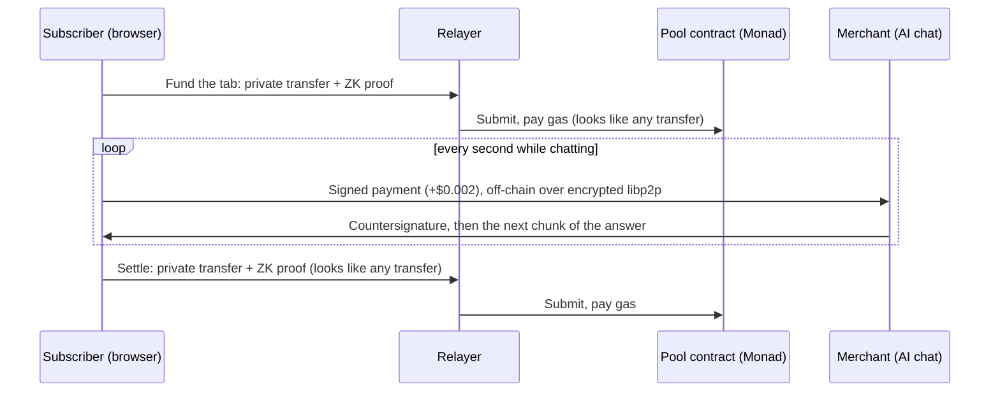
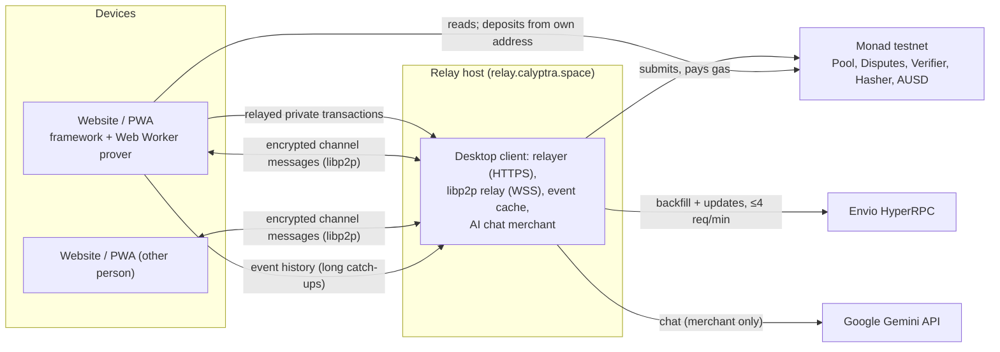

# Calyptra: private dollars, paid by the second

On a public blockchain every payment is public: who paid whom, how much and when. Salaries, rent,
suppliers and subscriptions become a permanent record anyone can read. Paying by the second makes this
worse, because every second becomes a public record.

**Calyptra** is a private payments app on Monad, for people who pay or get paid in dollars and for
services that charge by use:

- **Private balance.** Hold dollars (AUSD) and MON in a shielded pool.
- **Pay people privately.** One-off transfers to a friend's or freelancer's Calyptra ID, across borders.
  Nobody sees who paid whom or how much.
- **Pay services by the second.** Open a private subscription and pay every second while you use the
  service. Stop the moment you stop. Hundreds of payments, none of them on-chain.

Built for the **Monad Metropolis** hackathon, **Track 02 – Consumer Products & Payments**.

## Demo

- **Live app:** https://calyptra.space (Monad testnet; installable as a PWA)
- **Demo video:** _coming soon_
- **Pitch video:** _coming soon_

To try it, open the app and choose **Continue with passkey**. Get testnet MON and AUSD (see
[Testnet funds](#testnet-funds)), then use **Add money**. Under **Services**, subscribe to
"Calyptra AI · powered by Gemini" and chat while the meter runs.

## How it works

**The private balance is a shielded pool.** Money enters with a public deposit. Inside the pool, value
is held as sealed notes: commitments in a Merkle tree that hide the amount, the currency and the owner.
A transfer spends notes and creates new ones. A Groth16 zero-knowledge proof, made on the user's
device, shows the transfer is valid without revealing anything else. Every transfer has the same
shape: two inputs, three outputs, and a fee note for the relayer that submits it and pays the gas. So
no user address ever appears on a transfer.

**Tabs and subscriptions are private two-party payment channels whose funds are notes in that same
pool.** Opening a channel is an ordinary-looking private transfer. Paying inside it is an off-chain
signed message, exchanged directly between the two parties over encrypted libp2p: no proof and no
transaction. Settling is one more ordinary-looking transfer. From the outside, a subscription looks
exactly like two unrelated private payments. If one side disappears, the other settles alone through a
dispute that waits out a 3–7 day window.



## Why Monad

- **Fast enough to feel instant.** Blocks every 300 ms and about 600 ms finality, so opening a
  subscription takes about a second. On the live testnet, funding, the off-chain payments and settling a
  60-second session took under 15 seconds of waiting in total.
- **Zero-knowledge verification is affordable.** A relayed private transfer verifies a Groth16 proof
  and inserts three notes into a depth-20 Poseidon Merkle tree. That is about 2–2.6M gas, sent with a
  3.0M gas limit, and costs a fraction of a cent.
- **What only private channels add.** Paying privately every second on-chain would take 86,400
  zero-knowledge transactions a day per subscriber. A Calyptra subscription needs about three on-chain
  transactions, and all of them look like ordinary private transfers.
- **Built for Monad's execution model.**
  - The pool keeps its Merkle frontier and its 100-root history in fixed-size arrays, which suits
    Monad's paged storage.
  - Every transaction carries an explicit, measured gas limit, because Monad bills the declared limit.
  - The wallet follows Monad's reserve-balance rules.
- **Ecosystem:** Mera passkeys for accounts, AUSD as the dollar, and Envio HyperRPC for fast wallet sync.

**Contracts on Monad testnet** (chain id 10143, deployed at block 70436926, verified on Sourcify):

| Contract | Address |
|---|---|
| Pool | [`0x949a9e04fa9a0a619855c1cbf79da25d73152c13`](https://testnet.monadvision.com/address/0x949a9e04fa9a0a619855c1cbf79da25d73152c13) |
| Disputes | [`0xe33b1144efd35596a5cca72fc52941a442436145`](https://testnet.monadvision.com/address/0xe33b1144efd35596a5cca72fc52941a442436145) |
| Verifier (Groth16, 4 circuits) | [`0x2b1952402392a08e66e87c13a6ccfe1a9d1c190c`](https://testnet.monadvision.com/address/0x2b1952402392a08e66e87c13a6ccfe1a9d1c190c) |
| Hasher (Poseidon) | [`0x45cf6064e35df5feb4451843a5a63fe286b8f7e6`](https://testnet.monadvision.com/address/0x45cf6064e35df5feb4451843a5a63fe286b8f7e6) |
| AUSD (stablecoin, not ours) | [`0xa9012a055bd4e0edff8ce09f960291c09d5322dc`](https://testnet.monadvision.com/address/0xa9012a055bd4e0edff8ce09f960291c09d5322dc) |

A live 60-second subscription to the AI chat, as seen on-chain. Compare the funding and the settlement
with any other private transfer:

| Step | Transaction |
|---|---|
| Add money (public deposit) | [`0x0e1e…f133`](https://testnet.monadvision.com/tx/0x0e1e045f982848892b212590c7d481a7b25c124c926e28c14508dadcd185f133) |
| Subscribe (private transfer, relayed) | [`0x7348…f4e9`](https://testnet.monadvision.com/tx/0x7348333fa8a9dde1254fb2f28fd781b7d8b3028e50759ca69b6f860f83e0f4e9) |
| 63 per-second payments | none: off-chain |
| Settle (private transfer, relayed) | [`0x6f9a…22ba`](https://testnet.monadvision.com/tx/0x6f9a251a798032c2c7bc86240233f0df479e31b34d2b183e673e5f854a8022ba) |
| Cash out (private transfer with a public amount, relayed) | [`0xca5d…9daf`](https://testnet.monadvision.com/tx/0xca5db3f2d4efb357014eb92e8202fe59731a96c2379e9f590dcdd3c710d39daf) |

## Architecture

| Component | Path | Runs where | Responsibility |
|---|---|---|---|
| Circuits | `circuits` | build time; proving in the browser and Node | Four Circom/Groth16 circuits: transfer (2 in, 3 out, personal or channel unlock), submit state, finalize, reclaim. Trusted-setup pipeline. |
| Contracts | `contracts` (Foundry) | Monad | Pool (balances, commitment tree, root history, nullifiers), Disputes, the Groth16 verifier, the Poseidon hasher |
| Framework | `packages/framework` | browser and Node.js | The node as a library: wallet core and encrypted vault, pool keys, chain adapter, pool sync and transfers, channels, disputes, libp2p messaging, relayer, subscriptions and the merchant gate |
| Website | `apps/web` | static on a CDN (Cloudflare) | The only UI: React + Vite + viem, passkeys (Mera), IndexedDB storage, proving in a Web Worker, installable PWA |
| Desktop client | `apps/desktop` | user machine or relay host | CLI and local RPC server. Optional roles: transaction relayer, libp2p relay, event-history cache (`/hyperrpc`), AI chat merchant |
| Tests | `e2e` | CI and local | Integration (vitest on anvil with real proofs), UI (Playwright), live tests on Monad testnet |



**Design notes:**
- **Keys are derived, never stored in the clear.** One passkey (or recovery phrase) gives the public
  account, the vault key, the pool keys and every channel key.
- **Every persisted section is inside one encrypted document:** notes, channels and nicknames.
- **Wallet sync downloads all events of the pool.** The app never asks any server about a specific
  note.

## Tech stack

- **Smart contracts:** Solidity 0.8.37 (Foundry), with a circomlib-compatible Poseidon (t = 3) and a
  Groth16 verifier on the BN254 precompiles.
- **Zero knowledge:** Circom 2.2.3 and snarkjs (Groth16, BN254); circomlib Poseidon, EdDSA (Baby
  Jubjub) and range checks. Phase 1 uses the PSE perpetual powers of tau (2^17).
- **Cryptography:** X25519, HKDF-SHA256 and XChaCha20-Poly1305 (noble), BIP-39/BIP-32 (scure).
- **Framework:** TypeScript, viem, libp2p (circuit relay v2, WebSockets, Noise, Yamux), zod.
- **Website:** React 19, Vite, viem, @category-labs/mera (passkeys), Web Worker proving, PWA.
- **Desktop client:** Node.js 24, Express 5, pino.
- **Services:** Envio HyperRPC (event history) and Google Gemini (the demo merchant's model).
- **Tests:** Vitest, Foundry, Playwright.

## Setup

Requirements: Linux x64. Everything else installs into your home directory, with no sudo.

```sh
bash scripts/setup-tools.sh       # Node 24, circom 2.2.3, Foundry, the 2^17 powers of tau
source scripts/env.sh             # in every new shell
npm install
npm run setup                     # compile circuits, Groth16 setup, generate the verifier, test fixtures
npx playwright install chromium   # for the UI tests
```

### Run it locally

```sh
npm run demo                                  # a local chain (anvil) with fresh contracts, the desktop
                                              # client as relayer + libp2p relay, and the website
npm run demo -- fund <address> [native] [stable]  # test MON / test stablecoin for an account
npm run demo -- --testnet                     # the website + a local relayer/relay on Monad testnet
```

With `GEMINI_API_KEY` set, the demo also runs the AI chat merchant.

### Tests

```sh
npm test               # every tier: lint, typecheck, contracts-lint, framework, circuits,
                       # contracts, desktop, web, integration (anvil), ui (Playwright)
npm test -- --fast     # all but the integration and UI tiers
npm run test:live      # end to end on Monad testnet (needs ~/.calyptra-secrets/funder.key)
```

### Deploy to Monad testnet

1. **Contracts.** The deployer only needs MON for gas.
   ```sh
   CALYPTRA_DEPLOYER_KEY=0x… npm run deploy:network -- --network monad-testnet
   ```
   Put the printed addresses in `packages/framework/src/modules/chain/chain.config.ts`.
2. **Relay host and website** (Google Cloud VM + Cloudflare).
   ```sh
   CALYPTRA_ENVIO_TOKEN=… GEMINI_API_KEY=… npm run deploy:live -- --project <gcp-project>
   ```
   It needs:
   - the domain set in `scripts/deploy-live.ts`;
   - a Cloudflare token for that zone in `~/.calyptra-secrets/cloudflare.token`;
   - `wrangler login`;
   - a funded key in `~/.calyptra-secrets/funder.key`, which tops up the relayer.

   The script creates the VM, DNS and TLS (Caddy), installs the desktop client as relayer, libp2p relay,
   event cache and merchant, and deploys the website. It is idempotent.

### Desktop client

```sh
node apps/desktop/src/main.ts init --phrase      # CALYPTRA_PASSWORD / CALYPTRA_SECRET or prompted
node apps/desktop/src/main.ts start --relayer --relayer-account <unused account> --libp2p-relay
node apps/desktop/src/main.ts help
```

### Testnet funds

- **MON:** https://faucet.monad.xyz
- **AUSD:** the faucet contract `0xd236c18D274E54FAccC3dd9DDA4b27965a73ee6C`, `requestFunds(address)`,
  which pays 10,000 AUSD.

## Privacy model and limits

**Hidden:**
- which deposit a later payment or cash-out came from;
- that a tab or subscription exists, and who is paired with whom;
- amounts inside the pool;
- how many payments were made;
- the payment messages themselves.

These depend on the math (commitments, nullifiers, proofs), on the crowd (other users of the pool) and
on habits the app encourages: round amounts, a relayer paying gas, a fresh cash-out address.

**Never hidden:**
- deposits and cash-outs: address, currency, amount and time;
- what the other party of a tab learns about you;
- the fact that some channel is being settled during a dispute.

**Limits you should know:**
- **The trusted setup is for testing only.** The team ran the Groth16 phase-2 setup alone, so whoever
  kept its entropy could forge proofs. Production needs a multi-party ceremony.
- **The anonymity set is small.** A new pool has few users; privacy grows with use.
- **One operator sees timing.** On the demo deployment, the merchant and the relayer run on the same
  host, so that operator can correlate its own merchant's subscription fundings by timing.
- **A single-user relayer links transactions.** A relayer used by only one person ties that person's
  transactions together.
- **Not quantum-safe.** Encrypted notes stay on-chain forever.
- **Disputes need you online.** Until a watchtower exists, the app answers a dispute only while it is
  open, so open Calyptra at least every few days while you hold open tabs.

## AI disclosure

This project was built with the help of AI coding tools.

## Attribution

- [circomlib](https://github.com/iden3/circomlib), [snarkjs](https://github.com/iden3/snarkjs) and
  ffjavascript (GPL-3.0): circuits library, Groth16 proving and verification.
- [poseidon-solidity](https://github.com/vimwitch/poseidon-solidity) by Chance Hudson (MIT): the
  PoseidonT3 constants and arithmetic, vendored as an internal library in `contracts/lib`.
- [poseidon-lite](https://github.com/vimwitch/poseidon-lite) and
  [@zk-kit/baby-jubjub](https://github.com/privacy-scaling-explorations/zk-kit): Poseidon and Baby
  Jubjub in TypeScript.
- [PSE perpetual powers of tau](https://github.com/privacy-scaling-explorations/perpetualpowersoftau):
  phase 1 of the trusted setup.
- [Foundry](https://github.com/foundry-rs/foundry) and forge-std: contract builds and tests.
- [viem](https://viem.sh), [libp2p](https://libp2p.io) (with ChainSafe Noise and Yamux),
  [noble](https://paulmillr.com/noble/) and scure, [zod](https://zod.dev), React, Vite, Express, pino,
  qrcode.
- [@category-labs/mera](https://mera.category.xyz): passkey accounts.
- [Envio HyperRPC](https://envio.dev): event history for wallet sync.
- [Google Gemini API](https://ai.google.dev): the demo merchant's model.
- The Monad logo in the network selector comes from Monad's brand kit.

## License

[MIT](LICENSE). Third-party dependencies keep their own licenses; circomlib, snarkjs and ffjavascript
are GPL-3.0.
